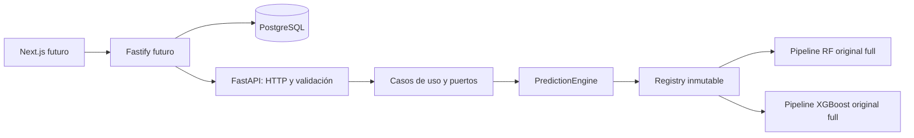

# Arquitectura del microservicio ML

Implementación de las etapas A–C de PROMPT7, en la distribución existente `depi-noshow-ml`. Estado de desarrollo: `FASTAPI_LOCAL_INTEGRATION_READY`. Estado científico de ambos modelos: `EXPLORATORY_NOT_VALIDATED`.

Fastify construye snapshots legítimos al reservar y conserva los identificadores. Python recibe únicamente las 19 predictoras, sin acceder a PostgreSQL, CSV de entrenamiento, etiquetas o persistencia de negocio.

| Responsabilidad C4 | Archivo / implementación | Alcance |
| --- | --- | --- |
| API de Predicción / `PredictNoShowRoute` | `src/depi_ml/api/routes/predictions.py` | APIRouter versionado, handlers delgados |
| `PredictNoShowHandler` | mismo archivo | Request → DTO → caso de uso → respuesta |
| Validación / `PredictionRequest` | `api/schemas/features.py`, `api/schemas/prediction.py` | Tipos estrictos, rangos, nulos, extras y coherencias |
| `PredictionInput` | `application/dto/prediction_input.py` | Dataclass inmutable con copia protegida del mapping |
| `PredictNoShow`, `CompareModels` | `application/use_cases/` | Orquestación mediante puertos, sin HTTP ni deserialización |
| Interfaces de motor/registro | `application/ports/` | Protocols reemplazables por fakes |
| Procesamiento / `FeaturePreprocessor` | pasos `contract` y `preprocess` del pipeline guardado | Reutilización directa de `training/preprocessing.py`; sin segundo transformador |
| Motor / `PredictionEngine` | `infrastructure/ml/prediction_engine.py` | Admisión acotada y resultados finitos |
| `RandomForestPredictor`, `XGBoostPredictor` | `infrastructure/ml/sklearn_predictor.py` | DataFrame crudo canónico → `pipeline.predict_proba` → clase 1 |
| `ModelRegistry` | `infrastructure/ml/model_registry.py` | Catálogo fijo, mapping inmutable, carga única por lifespan |
| Integridad | `infrastructure/ml/artifact_verifier.py` | SHA, procedencia, versiones, rutas y contrato |
| Clasificador de Riesgo / `RiskClassifier` | `domain/risk_classifier.py` | `null`, política pendiente de validación |
| Factores Asociados | Diferido a etapa D | No hay ruta ni atribuciones locales simuladas |
| `PredictionResult` | `application/dto/prediction_result.py` | Probabilidad e identidad del artefacto |
| Constructor / `PredictionResponse` | `api/mappers/prediction_mapper.py`, `api/schemas/` | Probabilidad por algoritmo, versión y estado experimental |
| Errores C4 | `domain/errors.py`, `api/exception_handlers.py` | `BasePredictionException`, `PredictionEngineException`, respuestas saneadas |
| Factory y ciclo de vida | `api/main.py` | Wiring, lifespan, publicación y liberación de registry |
| Configuración / controles HTTP | `infrastructure/config/api_settings.py`, `api/middleware.py`, `api/security.py` | Solo entorno ML, autenticación antes del parsing, límites |
| Correlación / logging | `infrastructure/telemetry/request_logging.py`, middleware y engine | Request ID opaco, ruta de contrato, duración e identidad; sin payloads |

El dominio no importa FastAPI, pandas, sklearn ni filesystem. La aplicación depende de puertos; infraestructura implementa los adaptadores. El middleware HTTP pertenece a presentación. No se renombran ni modifican los módulos ML anteriores.

Decisiones materializadas:

1. **Un paquete**: CLI offline y API opcional conviven. Importar la API no importa psycopg, pandas ni joblib; no carga `.env` ni artefactos.
2. **Dos modelos originales**: se sirven únicamente RF/XGB `full` del experimento original. RF es default provisional configurable; XGB sigue siendo comparador independiente. No se sirven candidatos de optimización ni `without_catalog`.
3. **Referencia fijada**: `ML_MODEL_MANIFEST_SHA256` es obligatorio para cargar. Detecta cambios del manifiesto respecto de una referencia confiable; no certifica procedencia por sí solo. Ambos hashes de modelo se verifican antes del primer `joblib.load`. Una copia temporal acotada conserva los bytes verificados durante la deserialización y se elimina al finalizar.
4. **Compatibilidad conservadora**: Python debe compartir major/minor y las versiones de pandas, NumPy, scikit-learn, XGBoost y joblib deben coincidir exactamente con el manifiesto. Cambiar bibliotecas exige nueva comprobación offline, sin downgrade automático. Se conserva la identidad histórica del código de entrenamiento; el hash global de serving cambia al añadir la API y se registra por separado.
5. **Readiness cerrada**: sin clave/configuración/activación o si falla cualquiera de los dos modelos, el proceso permanece vivo y todas las inferencias quedan en 503. No hay servicio parcial silencioso ni sustitución de XGB.
6. **Demo técnica explícita**: solo `development` con `ML_ALLOW_EXPERIMENTAL_INFERENCE=true` y clave válida. `production`/`staging` no habilitan estos modelos. `ML_API_MODE=production` es configuración inválida. La política no ofrece bandas de riesgo ni uso operativo.
7. **Contrato único**: nombres y orden provienen de `PREDICTOR_COLUMNS`. La tabla de tipos añade validaciones HTTP y comprueba igualdad del conjunto; no introduce variables. Contexto y versión se excluyen del DataFrame. Se prohíbe simular recálculo a 24 h modificando `booking_lead_days`.
8. **Recursos acotados**: máximo 256 KiB por defecto; lectura ASGI antes de Pydantic, incluso sin Content-Length. Dos inferencias simultáneas por worker; 429 sin cola adicional del motor. Acceso serializado por pipeline. La admisión se libera cuando la ejecución termina, también ante errores. No se anuncia un timeout de cómputo capaz de interrumpir sklearn: límites externos y aislamiento de procesos quedan para despliegue.
9. **Sin extensiones prematuras**: batch, SHAP local y umbrales quedan diferidos hasta aceptar A–C y definir sus controles. HU-01/02 tienen scores experimentales, HU-04 requiere otro protocolo temporal, HU-05 no está completa. CRUD, roles, campañas, sobreasignación, reportes y cargas de HU-01–22 siguen a cargo de Fastify/PostgreSQL.

La compra previa de bono se introdujo aproximadamente en junio–julio de 2026, con excepción presencial el mismo día si hay disponibilidad. Puede representar *concept drift*. Las tasas por **mes de cita** (20.92%, 7.15%, 4.78%, 2.58%) difieren de prevalencias por **mes de reserva** en validación. No prueban causalidad exclusiva de la política. No se añade esta información como predictor ni se inventa un día de implementación. Cortes, etiquetas e hiperparámetros permanecen intactos.

Quedan ocho controles metodológicos pendientes, calibración y bandas sin validar, sesgo de selección por elegibilidad/purga y candidatos no-show como etiqueta reconstruida. La meta ROC-AUC ≥0.80 **en prueba** sigue sin acreditarse; esta API no evalúa prueba. La integración local demuestra ejecución y paridad del pipeline, no generalización posterior al cambio comercial.

El patrón de carga compartida sigue [lifespan de FastAPI](https://fastapi.tiangolo.com/advanced/events/). Las restricciones de procedencia y entorno siguen [persistencia de scikit-learn](https://scikit-learn.org/stable/model_persistence.html). La validación HTTP usa [modo estricto de Pydantic](https://pydantic.dev/docs/validation/latest/concepts/strict_mode/).
